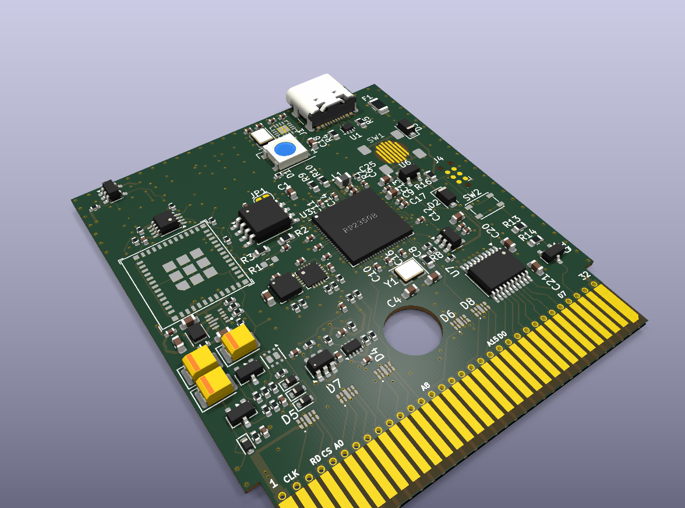
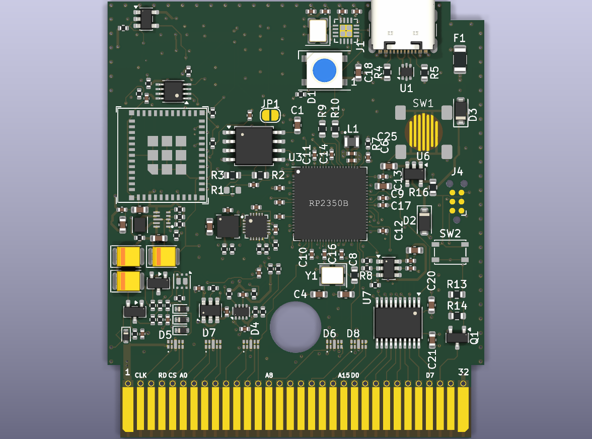
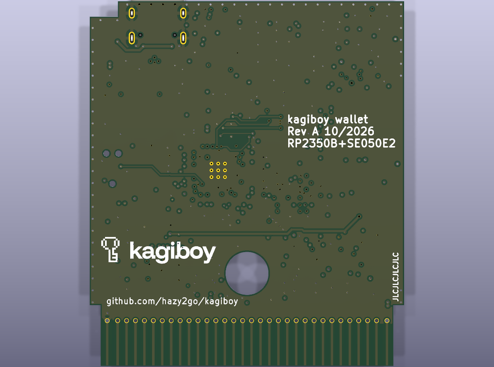

# kagiboy cartridge board (wallet variant)

Status (2026-10-15): designed, placed and routed, every check and simulation passing. Not ordered or built.

| Top | Back |
|---|---|
|  |  |

Base: the WiFi Game Boy Cartridge Rev B board, imported unmodified from
[hazy2go/wifi-game-boy-cartridge](https://github.com/hazy2go/wifi-game-boy-cartridge) at commit `326be60`
(`hw/rev-b` → `hw/wallet`, plus `verify/`, `docs/design/`, `sim/power/`, `sim/models/`).
That repo documents where its own design comes from. Hardware licence: CERN-OHL-P v2
(`hw/wallet/LICENSE-CERN-OHL-P.md`), inherited from it.

The first commit of this folder is the untouched import, so every later diff is the wallet change.

Wallet changes (done 2026-10-15, details in `LOGBOOK.md`):
- Removed: HyperRAM (U4), microSD (J2), RTC (U5, Y2), with their passives. DNP and off the board, still in
  the schematic.
- Added: NXP SE050E2 secure element (U110) on I2C1, RP2350 GPIO6/7, enable on GPIO10 (Deep Power-down
  wiring). LIS3DH accelerometer (U111) on I2C0, GPIO8/9, INT1 on GPIO11.
- Radio and power stage unchanged: the ESP32-C3 does Bluetooth LE to the phone, isolated from the wallet logic
  on its own chip.
- All gates pass, including a JLC manufacturability check at JLC's 6-layer limits. Firmware for every part:
  `firmware/rp2350` and `firmware/esp32c3`. Not ready to order: L1 is out of stock at JLC
  (`hw/wallet/fab/ORDER.md`).

## Checks and simulations (run from this folder)

| Check | Command | Result 2026-10-15 |
|---|---|---|
| ERC, DRC, unconnected, schematic/board parity vs the WiFi cart baseline | `python3 verify/kicad_check.py` | PASS, 0 new |
| JLC manufacturability: KiCad DRC at JLC's 6-layer limits (0.09 mm trace/space, 0.15/0.25 mm vias, 0.2 mm copper to edge) | `python3 verify/jlc_check.py` | PASS |
| Design netlist vs schematic | `python3 verify/netlist_check.py` | PASS |
| Design calculations (incl. both I2C buses) | `python3 verify/design_calcs.py` | all limits PASS |
| Power simulation parts vs schematic | `python3 verify/sim_vs_netlist.py` | PASS |
| Power stage, vendor SPICE models, A1-A7 / A8 | `cd sim/power && python3 audit.py` / `audit_inreg.py` | 81 / 114 PASS |
| Shell height | `hw/wallet/tools/height_check.py` (KiCad Python) | PASS |
| Routing tidiness vs the WiFi board | `hw/wallet/tools/route_audit.py` | 1 reviewed escape path |
| Pins vs JLC parts / placement vs JLC footprints | `hw/wallet/tools/pin_audit.py`, `make_cpl.py` | agree |
| Bus timing with the real ROM (repo root) | `cd web && pnpm sim` | 81.8 ns margin, 0 errors |

Tools: KiCad 10 (`kicad-cli` on PATH), ngspice, potrace. KiCad's Python needs numpy. The vendor SPICE models are
not committed: `python3 sim/models/fetch_models.py`. Decisions and results: `LOGBOOK.md`.
